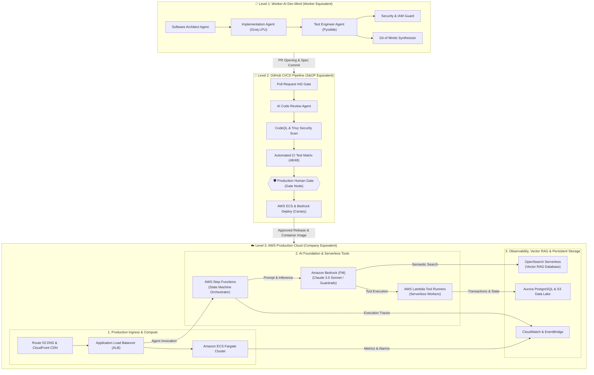

# ⚡ AI Factory CI/CD: Worker AI ➔ GitHub ➔ AWS Production Cloud

An interactive, browser-native 3-tier fractal studio modeling an autonomous CI/CD delivery pipeline from **Worker AI Cognition** to **GitHub Actions DevSecOps (S&OP)** to **AWS Production Cloud (Company)** with the complete 20-page **Human Intervention UI (HUI)**.

👉 **Live Interactive Canvas**: [https://cosmosanalytics.github.io/AWS/](https://cosmosanalytics.github.io/AWS/)

---

## 🏛️ 3-Tier Architecture Mapping

---

## 🎛️ Key Features & Human Intervention UI (HUI)

1. **3 Canonical Tiers**:
   - **Level 3: AWS Production Cloud**: Unified container compute (ECS Fargate, ALB, Route 53) and Generative AI Foundation stack (Bedrock, Step Functions, Lambda, OpenSearch Vector RAG, Aurora, S3, CloudWatch).
   - **Level 2: GitHub CI/CD & DevSecOps**: PR creation, AI code review, static analysis, Pyodide 48/48 unit tests, container builds, and **Human Gate**.
   - **Level 1: Worker AI Dev Mind**: Internal Society of Mind dialectical personas (Architect, Coder, Tester, Security Guard, Git Synthesizer).

2. **Human-in-the-Loop Governance**:
   - **Run Modes**: Instant switching between `Auto`, `Supervised` (halts at Human Gate), and `Step` (deterministic tick inspection).
   - **Live System State Badge**: `Waiting for you (1)`, `Running`, `Paused`, `EMERGENCY STOPPED`.
   - **Approvals Inbox with Multi-Tier Decision Cards**: Plain-English headline, why rationale, 4-cell impact grid (`$/latency/SLA/risk`), live Groq LPU rationale, and one-click `Approve & Deploy`, `Reject` (with chips), and `Batch Low-Risk`.
   - **Autonomy Policy Matrix**: Stage-by-stage `A / N / C / H` inline pill controls with hard cloud budget guardrails.
   - **Reversible Undo Ledger**: Time-windowed (30s) rollback with one-click instant state reversion.
   - **In-Browser AWS AI & Production Simulator**: Real-time ECS Fargate tasks, Blue/Green Canary traffic slider, Bedrock Foundation Model selector & Temperature Dial, Step Functions execution tracker, and live CloudWatch logs.

---

## 🚀 Quick Start

Open `index.html` in any modern web browser or visit the live deployment at [https://cosmosanalytics.github.io/AWS/](https://cosmosanalytics.github.io/AWS/).
Zero server setup or dependencies required.
